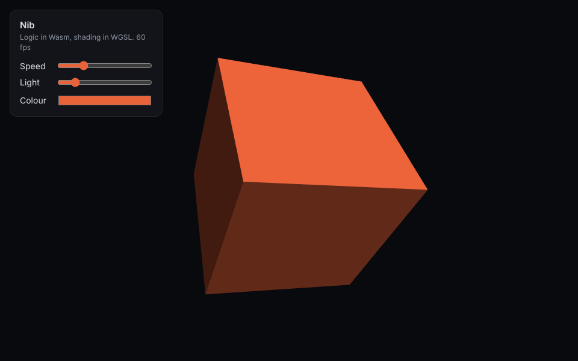
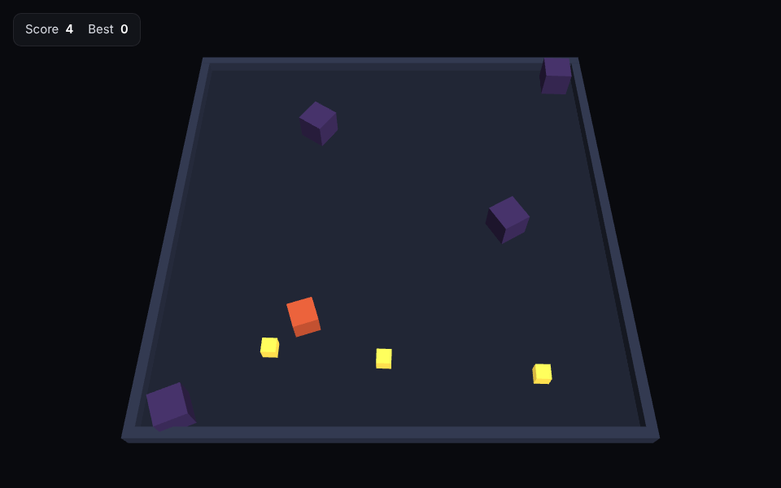

# Nib

Websites and web games written for WebAssembly directly: a small language whose rules are
Wasm's own, a compiler with no dependencies, and WGSL for shaders. The only JavaScript on a
page is a table of one-line bindings that the compiler writes.

| | |
|---|---|
|  |  |
| [`examples/cube`](examples/cube): a Lambert-lit cube with DOM controls | [`examples/game`](examples/game): game loop, input, dynamic memory, instancing |

| Shipped | Wasm | Bindings script | HTML |
|---|---|---|---|
| Cube | 4.53 kB (1.72 kB brotli) | 2.72 kB (1.11 kB) | 0.74 kB |
| Game | 8.84 kB (3.92 kB brotli) | 3.66 kB (1.42 kB) | 0.65 kB |

Both run under `Content-Security-Policy: default-src 'self'; script-src 'self' 'wasm-unsafe-eval'`:
no `eval`, no inline scripts, no inline styles.

## Run it

Needs [Bun](https://bun.sh). There is nothing to install.

```sh
bun run dev      # http://localhost:3000: compiles on every request, reloads on save, sends the policy above
bun run build    # writes dist/ with content-hashed file names
bun test
bun run bench    # needs clang with the wasm32 target and wasm-ld
```

A page opts in with one tag:

```html
<script type="nib" src="main.nib"></script>
```

The build turns it into `main-<hash>.wasm`, a preload for it, and `main-<hash>.js`, which holds
the bindings and starts the module by calling its exported `main`.

## Why a language

C needs a heavy optimiser largely to undo C: locals that might be addressed, pointers that might
alias, structs that live in memory. Nib cannot express those, so most of what an optimiser would
do is already true of the source.

- **Locals have no address.** Every local is a Wasm local; the browser's JIT puts it in a register.
- **Structs are values.** A struct local is its fields as separate locals, and a struct result is a
  multi-value return. Structs touch memory only through pointers.
- **Statics have fixed addresses**, so indexing one folds into a load's constant offset.
- **`inline fn` and `inline for` always expand**, and constant arguments stay constant inside.
- **Any expression can run at build time.** The compiler compiles it and runs it in its own
  engine, so the result is exactly what the page would have computed.
- **SIMD is a type** (`f32x4`), not something to hope the optimiser finds.
- **Only what an export reaches is emitted.**

The compiler is one pass from syntax tree to bytes, about 1,400 lines of TypeScript.

## The language in one page

```rust
import "std/math"                       // std/ ships with the compiler; other paths are relative

struct Vertex { px: f32, py: f32, pz: f32, nx: f32, ny: f32, nz: f32 }

const FOCAL = (1.0 / tan(0.436)) as f32        // constants are evaluated by the compiler
extern fn Math.tan(x: f64): f64                //   ...which may call JavaScript to do it

static uniforms: [f32x4; 10]                    // memory with a fixed address; `uniforms` is a *f32x4
static vertices: [Vertex; 24] = comptime build  // filled by running build(pointer) at build time
static table: [u16; 4] = [1, 2, 3, 4]

var rotation = Quat(0, 0, 0, 1)                 // Wasm globals; a struct takes one global per field
var frames = 0

inline fn lerp(a: f32, b: f32, t: f32): f32 { return a + (b - a) * t }

export fn update(dt: f32): f32 {                // every `export fn` is a Wasm export
  let total: f32 = 0                            // literals take the type they meet; alone, 1 is i32 and 1.0 is f32
  for i in 0..24 {
    let v = &vertices[i]                        // & works on memory, never on locals
    v.py += lerp(0, 9.8, dt)
    total += v.py > 0.0 ? v.py : -v.py
  }
  uniforms[0] = uniforms[1] * splat(dt) + f32x4(0, 0, 0, 1)
  return total
}
```

- **Types:** `i32 u32 i64 u64 f32 f64 bool`, `f32x4`, `ext` (any JavaScript value), `func` (a
  function reference), structs, pointers `*T`. `i8 u8 i16 u16` exist in memory and widen to `i32`.
- **Statements:** `let`, assignment and `+=` forms, `if`/`else`, `while`, `loop`,
  `for i in a..b`, `inline for`, `break`, `continue`, `return`. Semicolons are optional.
- **Operators** are C's, with `a & 1 == 0` meaning what it looks like, plus `as` casts and
  `c ? a : b`, which compiles to a branch-free `select` when both sides are cheap.
- **Built in:** `sqrt abs floor ceil trunc round min max clz ctz popcnt`, `splat` and `.x .y .z .w`
  on vectors, `sizeof`, `memcopy`, `memfill`, `memory_pages`, `memory_grow`, `heap_base`,
  `isnull`, `embed("file")`, `comptime expr`.

## Talking to the browser

Wasm can only call what it imports. A binding is declared once and then used like a function:

```rust
extern val document: ext                                     // a global value
extern fn requestAnimationFrame(cb: func): i32               // a function
extern new Uint8Array(buffer: ext): ext                      // a constructor
extern call GPUQueue.submit(commands: ext)                   // a method: the receiver comes first
extern get Element.clientWidth: i32                          // a property read
extern set Node.textContent: any                             // a property write
extern js now(): f64 = "() => performance.now()"             // anything else

on(getElementById(document, "speed"), "input", set_speed)    // a Nib function is a valid callback
```

For each distinct use the compiler writes one line of JavaScript with exactly that call's
arity. Object and array literals in Nib source become one such line too, with their constants
written in:

```rust
submit(queue, list)                                          // (a,b)=>a.submit(b)
createBuffer(device, { size, usage: UNIFORM | COPY_DST })    // (a)=>({size:a,usage:72})
```

The lines go into a table, and the module imports from it by position. This is the entire
script of a page (the cube's has 77 entries):

```js
WebAssembly.instantiateStreaming(fetch("main-1594si7a.wasm"),
  (F => ({ n1q4ra8a: [
    (a,b)=>a.getElementById(b),
    (a,b)=>({device:a,format:b}),
    globalThis.requestAnimationFrame||F,
    globalThis.document,
    "input",
    /* ... */
  ] }))(() => { throw Error("nib: missing binding") })
).then(r => r.instance.exports.main?.(r.instance.exports))
```

- The table's name is a hash of its contents, so a module can never link against a table from
  another build; build output is content-hashed for the same reason, and can be cached forever.
- A function the browser lacks becomes `F`, which throws when called rather than at load, so a
  page can feature-detect.
- Nothing is evaluated from strings at run time.

## The standard library

Six files of Nib, about 500 lines. A binding or function that is not used costs nothing.

| | |
|---|---|
| `std/math` | `sin`, `cos`, `clamp`, `random`; quaternions; 4×4 matrices on `f32x4` (`mat4_mul`, `mat4_perspective`, `mat4_look_at`, ...) |
| `std/mem` | `alloc`/`free` (size classes, grows memory on demand), `Arena` (bump, reset at once), `List` (packed items, swap-remove) |
| `std/input` | Keys mapped to action bits, `held(LEFT)` and `hit(JUMP)`, pointer position and press |
| `std/loop` | A fixed 120 Hz update with interpolated drawing: define `update(dt)` and `render(blend)` |
| `std/dom` | The common DOM bindings |
| `std/gpu` | WebGPU bindings, `gpu_start(canvas, ready, failed)`, `gpu_fit()`, `gpu_buffer(address, size, usage)` |

The game uses all of them. Its entities live in `List`s, each frame's instance data is built
in an `Arena` and uploaded from Wasm memory in one `writeBuffer`, and everything on screen is
one instanced draw call:

```rust
fn update(dt: f32) {                    // called by std/loop, 120 times a second
  let ax = (held(RIGHT) as i32 - held(LEFT) as i32) as f32
  ...
  let all = hazards.items as *Hazard
  for i in 0..hazards.count {
    let h = &all[i]
    h.x += h.vx * dt
    ...
  }
}
```

`std/loop` and the game find each other by name: there are no function pointers between Nib
functions, so `update` and `render` are direct calls.

## Measurements

All on one shared 4-core x86-64 machine; treat a few percent as noise. `bun run bench` rebuilds
and reruns everything except the browser pages, which are `bench/index.html` and
`bench/boundary.html`.

### Against C

The same eight kernels in [`bench/kernels.c`](bench/kernels.c) (`clang -O3 -msimd128`) and
[`bench/kernels.nib`](bench/kernels.nib), written the same way, run in the same engine. Every
kernel returns bit-identical results from both. Chromium 158, milliseconds per call, best of 7:

| Kernel | clang -O3 | Nib | Nib / C |
|---|---|---|---|
| hash: integer mixing | 47.4 | 41.7 | 0.88 |
| mat4: 4×4 products, written with `f32x4` | 12.6 | 10.9 | 0.87 |
| particles, written with `f32x4` | 2.6 | 2.5 | 0.96 |
| sieve: byte loads and stores | 6.6 | 6.4 | 0.97 |
| mandelbrot: f64 in locals | 30.1 | 30.2 | 1.00 |
| nbody: f64 structs in memory | 8.5 | 10.2 | 1.20 |
| fib: recursion | 7.7 | 13.1 | 1.70 |
| particles, written as a plain loop | 2.6 | 13.4 | 5.15 |

JavaScriptCore (Bun 1.4.4) shows the same picture. Its largest difference is `mat4`, where Nib is
1.17× clang's time instead of 0.87×.

Where Nib loses, and why:

- **Plain loops over arrays (5×).** LLVM turns the loop into SIMD by itself; Nib never does.
  Written with `f32x4`, the same loop matches LLVM's version.
- **Recursion (1.7×).** LLVM rewrites one of `fib`'s two recursive calls into a loop.
- **Repeated reads through pointers (1.2×).** LLVM proves two pointers differ and keeps values in
  registers; Nib reloads whatever the source reloads. Reading a field into a `let` fixes it.

Binaryen's `wasm-opt -O3` on Nib's output makes it 4–8% smaller and no faster on these kernels,
at 330 ms a run, so it is not part of the build.

### Calling the DOM from Wasm

Three ways to bind the same six DOM members, nanoseconds per call from Wasm, Chromium 158:

| Binding | method | getter | method, no arguments | plain function |
|---|---|---|---|---|
| Nib: one arrow per call shape | 31 | 9 | 59 | 11 |
| `Function.prototype.call.bind(native)` | 34 | 15 | 67 | 11 |
| One generic closure per kind (`o[name](...args)`) | 36 | 9 | 70 | 11 |

Setters and layout-dependent getters cost 215–240 ns under every scheme: the browser's own work
dominates. An arrow matches hand-written glue because that is what it is.

### Compile time

| | |
|---|---|
| The cube: 570 lines with the libraries it imports | 3.5 ms |
| The game: 990 lines with the libraries it imports | 5.3 ms |
| `nib build examples`, both sites, from a cold start | 90 ms |

## Limits

- No auto-vectorisation, no alias analysis, no loop restructuring. Speed comes from writing the
  fast form, and the language is small enough that the fast form is usually the obvious one.
- One global namespace; no closures, generics, methods or function pointers between Nib functions.
- Strings exist only as `ext` values. Building one means calling JavaScript.
- `free` needs the size, and freed memory is never returned to the browser.
- Wasm GC types are not used.
- Verified in Chromium 158 with WebGPU on a software adapter, including keyboard and pointer play
  and the strict policy above. Everything without a DOM is also tested in Bun and Node. Not yet
  run in Firefox or Safari, or on a real GPU or touch screen.

## Layout

```
nib/        syntax.ts (lexer, parser)   compiler.ts (checker, emitter)   loader.ts   cli.ts
std/        math   mem   input   loop   dom   gpu
examples/   cube/   game/   shared/cube.nib
bench/      kernels.nib   kernels.c   boundary.nib   harness.js   run.ts   *.html
test/       compiler.test.ts
```
