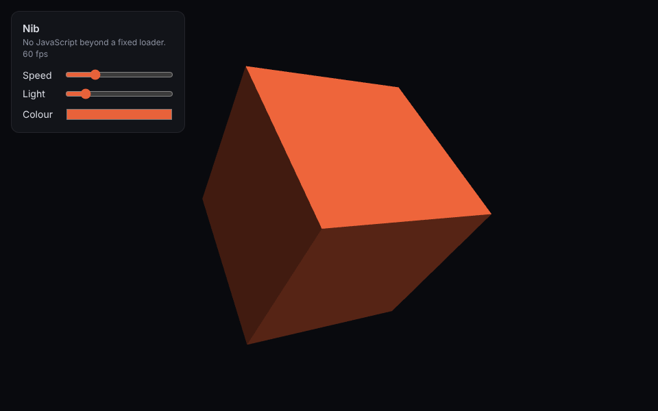

# Nib

Websites and web games written for WebAssembly directly: a small language whose rules are
Wasm's own, a compiler with no dependencies, WGSL for shaders, and 314 bytes of JavaScript that
never change.



The demo is a spinning, Lambert-lit, antialiased cube on WebGPU with a small DOM control panel.
Its logic is [`demo/main.nib`](demo/main.nib) and [`demo/cube.wgsl`](demo/cube.wgsl); the page
is static HTML and CSS.

| Shipped file | Raw | Brotli |
|---|---|---|
| `main.wasm` (logic, bindings, shader source, geometry) | 6.13 kB | 2.68 kB |
| `index.html` (markup, CSS, the loader) | 1.83 kB | 0.76 kB |

## Run it

Needs [Bun](https://bun.sh). There is nothing to install.

```sh
bun run dev      # http://localhost:3000: compiles on every request, reloads on save
bun run build    # writes dist/
bun test
bun run bench    # needs clang with the wasm32 target and wasm-ld
```

A page opts in with one tag; the build replaces it with the inline loader:

```html
<script type="nib" src="main.nib"></script>
```

## Why a language

C needs a heavy optimiser largely to undo C: locals that might be addressed, pointers that might
alias, structs that live in memory. Nib cannot express those, so most of what an optimiser would
do is already true of the source.

- **Locals have no address.** Every local is a Wasm local; the browser's JIT puts it in a register.
- **Structs are values.** A struct local is its fields as separate locals, and a struct result is a
  multi-value return. Structs touch memory only through pointers.
- **Statics have fixed addresses**, so indexing one folds into a load's constant offset.
- **`inline fn` and `inline for` always expand**, and constant arguments stay constant inside.
- **Any expression can run at build time.** The compiler compiles it and runs it in its own
  engine, so the result is exactly what the page would have computed.
- **SIMD is a type** (`f32x4`), not something to hope the optimiser finds.
- **Only what an export reaches is emitted.**

The compiler is one pass from syntax tree to bytes, about 1,400 lines of TypeScript.

## The language in one page

```rust
import "std/math"                       // std/ ships with the compiler; other paths are relative

struct Vertex { px: f32, py: f32, pz: f32, nx: f32, ny: f32, nz: f32 }

const FOCAL = (1.0 / tan(0.436)) as f32        // constants are evaluated by the compiler
extern fn Math.tan(x: f64): f64                //   ...which may call JavaScript to do it

static uniforms: [f32x4; 10]                    // memory with a fixed address; `uniforms` is a *f32x4
static vertices: [Vertex; 24] = comptime build  // filled by running build(pointer) at build time
static table: [u16; 4] = [1, 2, 3, 4]

var rotation = Quat(0, 0, 0, 1)                 // Wasm globals; a struct takes one global per field
var frames = 0

inline fn lerp(a: f32, b: f32, t: f32): f32 { return a + (b - a) * t }

export fn update(dt: f32): f32 {                // every `export fn` is a Wasm export
  let total: f32 = 0                            // literals take the type they meet; alone, 1 is i32 and 1.0 is f32
  for i in 0..24 {
    let v = &vertices[i]                        // & works on memory, never on locals
    v.py += lerp(0, 9.8, dt)
    total += v.py > 0.0 ? v.py : -v.py
  }
  uniforms[0] = uniforms[1] * splat(dt) + f32x4(0, 0, 0, 1)
  return total
}
```

- **Types:** `i32 u32 i64 u64 f32 f64 bool`, `f32x4`, `ext` (any JavaScript value), `func` (a
  function reference), structs, pointers `*T`. `i8 u8 i16 u16` exist in memory and widen to `i32`.
- **Statements:** `let`, assignment and `+=` forms, `if`/`else`, `while`, `loop`,
  `for i in a..b`, `inline for`, `break`, `continue`, `return`. Semicolons are optional.
- **Operators** are C's, with `a & 1 == 0` meaning what it looks like, plus `as` casts and
  `c ? a : b`, which compiles to a branch-free `select` when both sides are cheap.
- **Built in:** `sqrt abs floor ceil trunc round min max clz ctz popcnt`, `splat` and `.x .y .z .w`
  on vectors, `sizeof`, `memcopy`, `memfill`, `isnull`, `embed("file")`, `comptime expr`.

## Talking to the browser

Wasm can only reach the DOM and WebGPU through imported JavaScript functions. In Nib, a module's
import section is its binding manifest: each import *names the JavaScript it wants*.

```rust
extern val document: ext                                     // a global value
extern fn requestAnimationFrame(cb: func): i32               // a function
extern new Uint8Array(buffer: ext): ext                      // a constructor
extern call GPUQueue.submit(commands: ext)                   // a method: the receiver comes first
extern get Element.clientWidth: i32                          // a property read
extern set Node.textContent: any                             // a property write
extern js now(): f64 = "() => performance.now()"             // anything else

on(getElementById(document, "speed"), "input", set_speed)    // a Nib function is a valid callback
```

For a call such as `submit(queue, list)` the compiler imports the field `(a,b)=>a.submit(b)`
from the module `js`. Object and array literals are JavaScript too, built in one call with
their constants written into the source:

```rust
createBuffer(device, { size, usage: UNIFORM | COPY_DST, label: "uniforms" })
// imports:  (a)=>({size:a,usage:72,label:"uniforms"})
```

The loader evaluates each import once at startup. This is all of it:

```js
function runtime() {
  const run = eval
  const table = resolve => new Proxy({}, { get: (_, field) => resolve(field) })
  return {
    str: table(text => text),                                    // string constants
    val: table(source => { try { return run(source) } catch { } }),
    js: table(source => {
      let f
      try { f = run(source) } catch { }
      return f ?? (() => { throw Error('nib: no ' + source) })   // missing APIs fail when called, not at load
    }),
  }
}
WebAssembly.instantiateStreaming(fetch('main.wasm'), runtime())
  .then(r => r.instance.exports.main?.(r.instance.exports))
```

It needs a Content-Security-Policy that allows `'unsafe-eval'`. A strict-CSP build would have
the compiler write the same arrows into the page as a static table; that is not implemented.

## Measurements

All on one shared 4-core x86-64 machine; treat a few percent as noise. `bun run bench` rebuilds
and reruns everything except the browser pages, which are `bench/index.html` and
`bench/boundary.html`.

### Against C

The same eight kernels in [`bench/kernels.c`](bench/kernels.c) (`clang -O3 -msimd128`) and
[`bench/kernels.nib`](bench/kernels.nib), written the same way, run in the same engine. Every
kernel returns bit-identical results from both. Chromium 158, milliseconds per call, best of 7:

| Kernel | clang -O3 | Nib | Nib / C |
|---|---|---|---|
| hash: integer mixing | 47.4 | 41.7 | 0.88 |
| mat4: 4×4 products, written with `f32x4` | 12.6 | 10.9 | 0.87 |
| particles, written with `f32x4` | 2.6 | 2.5 | 0.96 |
| sieve: byte loads and stores | 6.6 | 6.4 | 0.97 |
| mandelbrot: f64 in locals | 30.1 | 30.2 | 1.00 |
| nbody: f64 structs in memory | 8.5 | 10.2 | 1.20 |
| fib: recursion | 7.7 | 13.1 | 1.70 |
| particles, written as a plain loop | 2.6 | 13.4 | 5.15 |

JavaScriptCore (Bun 1.4.4) shows the same picture. Its largest difference is `mat4`, where Nib is
1.17× clang's time instead of 0.87×.

Where Nib loses, and why:

- **Plain loops over arrays (5×).** LLVM turns the loop into SIMD by itself; Nib never does.
  Written with `f32x4`, the same loop matches LLVM's version.
- **Recursion (1.7×).** LLVM rewrites one of `fib`'s two recursive calls into a loop.
- **Repeated reads through pointers (1.2×).** LLVM proves two pointers differ and keeps values in
  registers; Nib reloads whatever the source reloads. Reading a field into a `let` fixes it.

Binaryen's `wasm-opt -O3` on Nib's output makes it 4–8% smaller and no faster on these kernels,
at 330 ms a run, so it is not part of the build.

### Calling the DOM from Wasm

Three ways to bind the same six DOM members, nanoseconds per call from Wasm, Chromium 158:

| Binding | method | getter | method, no arguments | plain function |
|---|---|---|---|---|
| Nib: one arrow per call shape | 31 | 9 | 59 | 11 |
| `Function.prototype.call.bind(native)` | 35 | 15 | 67 | 12 |
| One generic closure per kind (`o[name](...args)`) | 36 | 9 | 72 | 12 |

Setters and layout-dependent getters cost 210–245 ns under every scheme: the browser's own work
dominates. An arrow matches hand-written glue because that is what it is.

### Compile time and size

| | |
|---|---|
| The demo, 384 lines including the standard library | 2.5 ms warm; `nib build` takes 60 ms end to end |
| The benchmark kernels | 1.5 ms, 3.2 kB (clang: 4.5 kB) |
| Loader | 314 bytes, the same for every program |

## Limits

- No auto-vectorisation, no alias analysis, no loop restructuring. Speed comes from writing the
  fast form, and the language is small enough that the fast form is usually the obvious one.
- Memory is static: there is no allocator and no `memory.grow` yet. Games tend to want pools.
- One global namespace; no closures, generics, methods or indirect calls between Nib functions.
- Strings exist only as `ext` values. Building one means calling JavaScript.
- Wasm GC types are not used.
- Tested in Chromium 158 (WebGPU through SwiftShader) and in Bun and Node for everything without a
  DOM. Not yet run in Firefox or Safari.

## Layout

```
nib/       syntax.ts (lexer, parser)   compiler.ts (checker, emitter)   loader.ts   cli.ts
std/       math.nib   dom.nib   gpu.nib
demo/      index.html   main.nib   cube.wgsl
bench/     kernels.nib   kernels.c   boundary.nib   harness.js   run.ts   *.html
test/      compiler.test.ts
```
